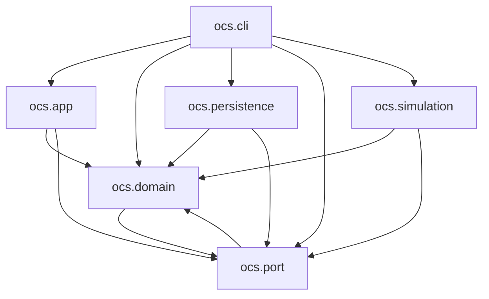

# Lab Report, Intended and Implemented Architecture
Repository URL: 

## Tools

| Item | Version or name |
| --- | --- |
| JDK | OpenJDK 25.0.5 (Temurin)|
| Maven | Apache Maven 3.10.0 |
| IDE | Visual Studio Code 1.146.0 |
| AI tool and exact model, if you used one | Google Gemini | 

## Part A: Compare ParcelPoint with its package diagram

Answer questions 1 and 2 in Question 1 of the quiz.
1. Explain why jdeps reads the folder target/classes rather than the .java files, and state what jdeps prints if you run it before mvn package.

```text
    jdeps is a Java class dependency analyzer that operates on compiled Java bytecode (.class files) rather than raw .java source files, because compiled .class files contain the resolved symbolic references and package dependencies generated by the compiler. If you run jdeps before running mvn package, Maven has not compiled the project or created the target/classes directory yet, so jdeps prints: Warning: Path does not exist: target/classes.
```

2. Explain why the lines parcelpoint.domain -> parcelpoint.domain and parcelpoint.storage -> parcelpoint.storage do not count as dependencies between packages.

```text
    These lines represent intra-package dependencies (internal usage between classes within the same package) rather than inter-package dependencies (dependencies across different packages). For example, Locker uses Parcel inside parcelpoint.domain, and H2ParcelRepository implements ParcelRepository inside parcelpoint.storage. Because a package diagram only models structural dependencies between distinct packages, self-referencing arrows are omitted.
```

3. State whether the implemented architecture of ParcelPoint matches its intended architecture, and justify your answer with what you found in the comparison.

```text
    Yes, the implemented architecture of ParcelPoint matches its intended architecture.

    When comparing the Mermaid flowchart generated from the jdeps output against the intended package diagram in both directions, all eight package dependencies align one-to-one:
    - parcelpoint depends on cli, service, and storage.
    - cli depends on service and domain.
    - service depends on storage and domain.
    - storage depends on domain.
    There are no missing dependencies from the design and no unauthorized extra dependencies (such as cli skipping directly to storage or cycles between packages) in the code.
```

4. Main sits in the package parcelpoint, and it depends on storage, while cli must not depend on storage. Explain why the design allows the first dependency and forbids the second.

```text
    Main acts as the Composition Root (entry point) of the application, where all components are instantiated and wired together via Dependency Injection—creating H2ParcelRepository, passing it into ParcelService, and passing ParcelService into ParcelCommandLine. Therefore, Main must know about all layers to assemble the system. In contrast, cli is the presentation layer in a Layered Architecture, which must only communicate with the adjacent service layer to keep user interaction decoupled from database implementation details.

```

## Part B: Plant drift and find it

5. Predict the new line that jdeps will print after this change.

```text
   The new dependency line that jdeps will print is parcelpoint.cli -> parcelpoint.storage.
```

6. Identify the rule of the layered style that this change breaks, and explain what would happen to ParcelCommandLine if the team moved from H2 to a file store.

```text
    - Rule broken: This change violates the strict layering (no layer-skipping) rule of the layered architectural style, which requires a layer (cli) to communicate only with the layer directly below it (service), rather than bypassing it to access the storage layer directly.
    - Impact when moving to a file store: Because ParcelCommandLine is now tightly coupled to the concrete H2ParcelRepository class and its database path (./data/parcelpoint), switching to a file-based repository will require modifying ParcelCommandLine (the presentation layer) as well, or it will read from the wrong data source instead of the new file store.
```

7. Explain why the class view of this step helps more than the package view of Step B1 when you have to fix the drift.

```text
    In a large codebase, a single package can contain dozens of classes, so the package view (-verbose:package) only tells you which two packages have an unauthorized dependency (parcelpoint.cli -> parcelpoint.storage), without showing where it happens. The class view (-verbose:class) pinpoints the exact offending source class and the target class it references (parcelpoint.cli.ParcelCommandLine -> parcelpoint.storage.H2ParcelRepository), allowing you to open the right file immediately and fix the drift without manually searching through every file in the package.
```

8. Explain why the cycle between domain and storage makes both packages harder to change, test and reuse. Use a term from cohesion, coupling and connascence in your answer.

```text
    Introducing a cycle creates tight cyclic coupling (mutual dependency) between domain and storage, meaning neither package can stand independently without the other:
    - Harder to change: Because of high coupling and connascence (specifically Connascence of Name and Type on ParcelRepository), changes to persistence interfaces or storage logic in storage can ripple back into core business entities in domain, and vice versa, forcing both packages to be modified and recompiled together.
    - Harder to test: You cannot unit-test Parcel in isolation as a pure domain object anymore; every test involving Parcel must now bring in or mock ParcelRepository from the storage package.
    - Harder to reuse: The domain package is no longer self-contained, so you cannot reuse Parcel in another application (such as a mobile client or a system using a different persistence mechanism) without also pulling in the storage package.
```

9. Both changes compiled and ran, although they broke the design. Explain why the compiler accepted them, and why a team therefore needs a separate check such as jdeps.

```text
   - Why the compiler accepted them: The Java compiler (javac) only enforces language-level syntax, type safety, and access modifiers (such as public or package-private visibility). Because H2ParcelRepository and ParcelRepository are both declared public, javac treats calls to them as completely valid Java code; it has no knowledge of the team's architectural rules, layering boundaries, or dependency direction constraints.
    - Why a team needs a separate check such as jdeps: Without an automated structural analysis tool like jdeps (ideally integrated into a CI pipeline or code review), architectural drift—such as layer-skipping shortcuts and cyclic dependencies—can silently enter the codebase without triggering any build errors, gradually eroding maintainability and modularity over time.
```

## Part C: Check your Phase 2 code

10. Paste the jdeps output of Step C2 and your Mermaid flowchart.

```text
    **jdeps output:**
```text
classes -> target/classes
   ocs.app                                            -> ocs.app                                            classes
   ocs.app                                            -> ocs.domain                                         classes
   ocs.app                                            -> ocs.port                                           classes
   ocs.cli                                            -> ocs.app                                            classes
   ocs.cli                                            -> ocs.cli                                            classes
   ocs.cli                                            -> ocs.domain                                         classes
   ocs.cli                                            -> ocs.persistence                                    classes
   ocs.cli                                            -> ocs.port                                           classes
   ocs.cli                                            -> ocs.simulation                                     classes
   ocs.domain                                         -> ocs.domain                                         classes
   ocs.domain                                         -> ocs.port                                           classes
   ocs.persistence                                    -> ocs.domain                                         classes
   ocs.persistence                                    -> ocs.persistence                                    classes
   ocs.persistence                                    -> ocs.port                                           classes
   ocs.port                                           -> ocs.domain                                         classes
   ocs.simulation                                     -> ocs.domain                                         classes
   ocs.simulation                                     -> ocs.port                                           classes
```

**Mermaid flowchart:**

```

11. List every difference and every cycle that you found, using the table below, and state for each one whether you would fix the design or the code, with one reason. If you found no difference, state that.

| What you found | Where | What you would fix |
| :--- | :--- | :--- |
| An arrow in the code that the diagram does not show | `ocs.cli -> ocs.domain` | **Fix the design**: Add this dependency to the package diagram because CLI classes genuinely need to construct and display domain value types (such as `TargetCoordinates` and `InstrumentSettings`) when interacting with the user. |
| An arrow in the code that the diagram does not show | `ocs.cli -> ocs.port` | **Fix the design**: Add this dependency to the package diagram because `OcsMain` (the composition root in `ocs.cli`) wires concrete implementations to port interfaces when injecting dependencies into application services. |
| An arrow in the code that the diagram does not show | `ocs.domain -> ocs.port` | **Fix the code**: Remove the dependency on `ocs.port` from `ocs.domain` so that domain entities remain pure and independent of external port interfaces, which also resolves the package cycle. |
| A cycle between packages | `ocs.domain <-> ocs.port` | **Fix the code**: Break the cycle by keeping `ocs.port -> ocs.domain` (so port interfaces can use domain types in their signatures) and moving any port calls out of `ocs.domain` into `ocs.app` services. |

## AI usage declaration

| AI tool and exact model | Date | Purpose | Files or answers it produced or changed | How you checked its output |
| --- | --- | --- | --- | --- |
| Google Gemini (Gemini 3) | 27 November 2026 | Explain `jdeps` architecture analysis concepts, troubleshoot Git repository structure, and draft report explanations for Parts A, B, and C | `LAB_REPORT.md` (drafted answers for Questions 1–8 and 11) | Ran `mvn package` and `jdeps` commands in Terminal to verify actual dependencies, compared Mermaid diagrams on mermaid.live against the package diagrams, and inspected the Java source files directly |
